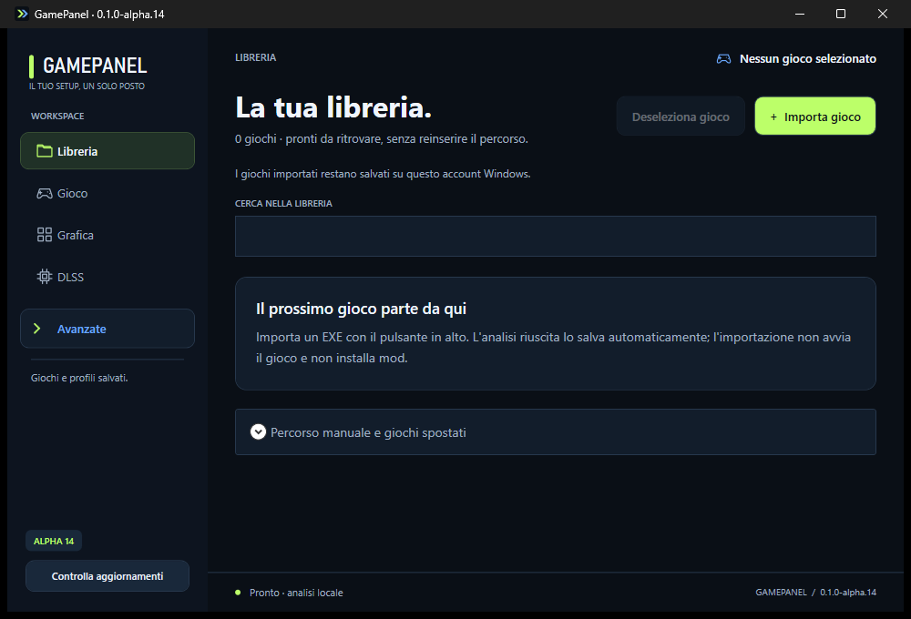
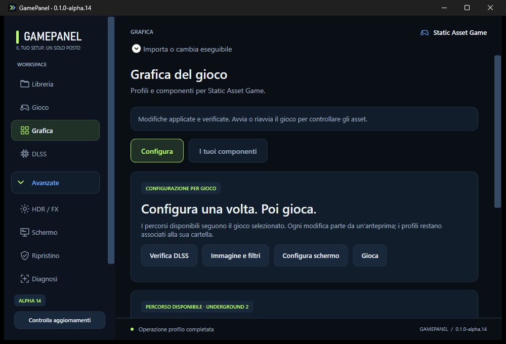

# GamePanel — DLSS e ReShade per i tuoi giochi

GamePanel è un’app Windows che riunisce in un’unica interfaccia la libreria dei giochi e la gestione delle configurazioni grafiche. Permette di importare un gioco dal suo eseguibile, analizzarne i componenti e accedere alle funzioni disponibili per quel titolo.

Il progetto comprende la gestione delle configurazioni DLSS per le copie RTX Remix riconosciute, gli strumenti HDR/ReShade e l’importazione di pacchetti grafici compatibili, con backup e ripristino. Le opzioni specifiche compaiono in base al gioco selezionato; gli strumenti tecnici sono raccolti in **Avanzate**. La compatibilità dipende dal gioco e dai componenti installati.

## Download

**[Scarica GamePanel alpha.14 per Windows x64 — archivio ZIP](https://github.com/luigip11/GamePanel/actions/runs/41512123911/artifacts/13174356555)**

La build alpha.14 è distribuita come artefatto GitHub Actions: per scaricarla serve accedere a GitHub. Estrarre l’archivio e avviare GamePanel. Giochi, asset e runtime RTX Remix non sono inclusi.

## Changelog alpha.14

- Chevron vettoriali uniformi per aprire e chiudere i menu **Avanzate** nella sidebar e nei parametri DLSS.
- Illustrazioni minimali verde fluo accanto alle scelte DLSS, Ray Reconstruction, Frame Generation e Reflex.
- Nuovo pulsante **Deseleziona gioco** nella libreria: rimuove il contesto attivo mantenendo giochi, profili e file.
- Altezza di **Deseleziona gioco** allineata a **Importa gioco**.

Verifica su Windows: **231/231 controlli superati**, inclusa la deselezione del gioco dalla libreria.

## Schermate

Schermate reali di GamePanel alpha.14 nell’ambiente di test Windows; le voci dei giochi sono dimostrative.

### Libreria

### Grafica e contenuti

