# GamePanel — giochi, grafica e configurazioni

GamePanel è un’app Windows per importare i giochi dal loro EXE, organizzarli in libreria e gestire le configurazioni grafiche compatibili. Analisi locale, backup, ripristino e varianti Originale/Remix seguono la copia selezionata.

Le funzioni vengono proposte in base al gioco, al renderer e all'hardware rilevati. GamePanel non aggiunge DLSS o HDR a un titolo che non li supporta.

## Download

**[Scarica GamePanel alpha.16 per Windows x64](https://github.com/luigip11/GamePanel/actions/runs/42228867851/artifacts/13507551076)** · [Build e controlli superati](https://github.com/luigip11/GamePanel/actions/runs/42228867851). Il download degli artifact richiede accesso a GitHub e resta disponibile fino al 4 febbraio 2027.

Per usare una build portabile, estrarre tutto lo ZIP in una cartella nuova e aprire **GamePanel.exe**. Runtime dell’app incluso; guide in **Docs**, licenze in **Licenses**, materiali in **Assets**. Giochi e pacchetti Remix non sono inclusi.

## Changelog alpha.16

- UI Windows aggiornata al prototipo approvato: schede libreria adattive, icone informative, ricerca con lente e ordinamento recenti/meno recenti/alfabetico oltre cinque giochi.
- Avvia/Analizza, tab Grafica e pulsanti backup divisi a metà riga; azioni secondarie separate da un divisore.
- Copertina selezionata nel riquadro Gioco; informazioni Windows accessibili dal pannello hardware; Gioca e Avvia il gioco a tutta larghezza.
- Gioca nella pagina DLSS sopra la FAQ; campi di configurazione scuri, hover più visibili, icona aggiornamenti e collegamento al profilo GitHub dell'autore nel footer.
- Hardware distinto in processore, GPU e RAM installata, con valori rilevati da Windows.
- Schermo illustrato con risoluzione al centro, monitor e risoluzione affiancati, configurazione avanzata separata.
- Punti di ripristino con conteggio, gioco/percorso, Esamina ed eliminazione confermata del singolo backup; spaziatura prima delle FAQ.
- Preparazione locale UG1/UG2 Remix da cartella o ZIP verificato: anteprima, copia separata, annullamento, esportazione locale dei soli file catalogati e collegamento Originale/Remix. [Guida](docs/REMIX-PACKAGES.md).
- Preparazione degli allegati per GitHub Releases in parti inferiori a 2 GiB, manifest SHA-256 e ricostruzione locale verificata dello ZIP; nessun upload automatico.
- UG2 conserva FrontB.lzc dell'utente; Smol è un componente separato. Le configurazioni personalizzate vengono segnalate e conservate. Il download pubblico GamePanel resta disabilitato finché i pacchetti distribuibili non sono pubblicati.
- Preset ReShade generali Originale, Nitido, Bilanciato e Cinema per EXE **x86 Direct3D 9** compatibili, con componente ufficiale verificato, anteprima e ripristino. Nessuna installazione automatica sopra Remix. [Immagine e HDR](docs/IMAGE-AND-HDR.md).
- Pagina HDR separata: rilevamento Windows in sola lettura del colore avanzato e accesso alle impostazioni HDR, distinguendo HDR nativo, Auto HDR e filtri SDR.
- Metadati versione EXE conservati nella libreria quando disponibili; nessuna patch dedotta dal nome del file.

Le copie preparate richiedono una prova nel gioco. Il collaudo di una configurazione su RTX 5080 Laptop non garantisce prestazioni o stabilità su altri PC. Il download pubblico delle mod è distinto dall'importazione locale e richiede pacchetti ospitati, integrità verificata e condizioni di distribuzione rispettate.

## Schermate

Le anteprime mostrano la UI finale di alpha.16: Libreria, Gioco e hardware, Grafica, DLSS, Schermo, HDR e Backup.

Catture della vera app WPF alpha.16 su Windows, con libreria dimostrativa isolata e copertine illustrative locali. L'hardware mostrato nella pagina Gioco appartiene al runner Windows; non rappresenta il PC dell'utente. Nessun gioco viene eseguito per produrre queste immagini.

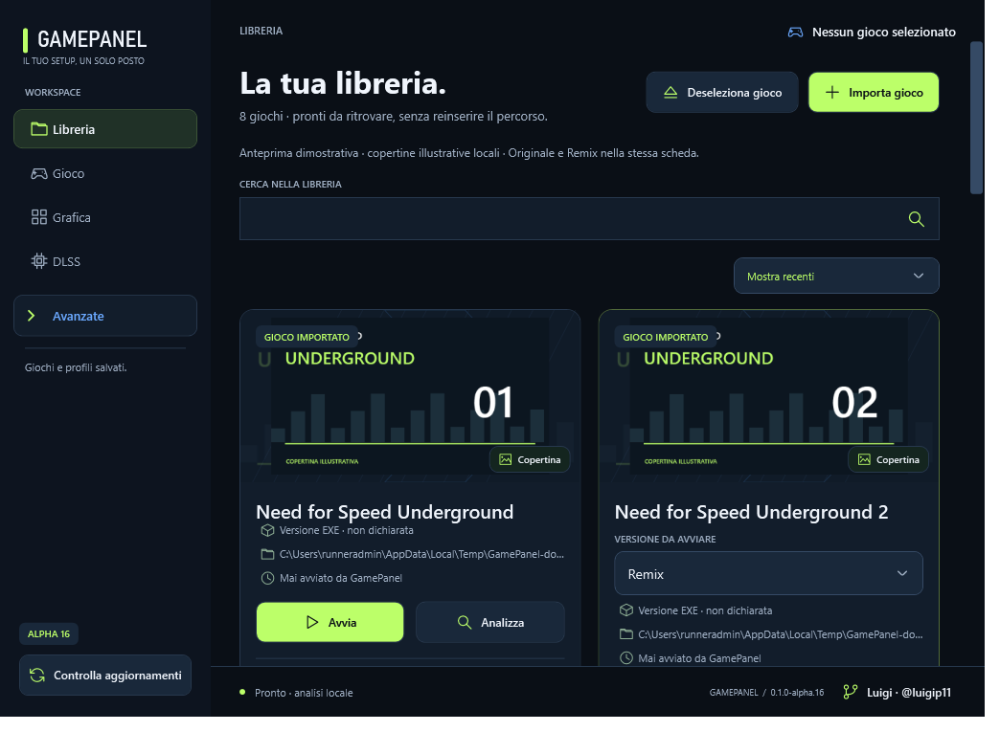

Azioni delle schede della libreria

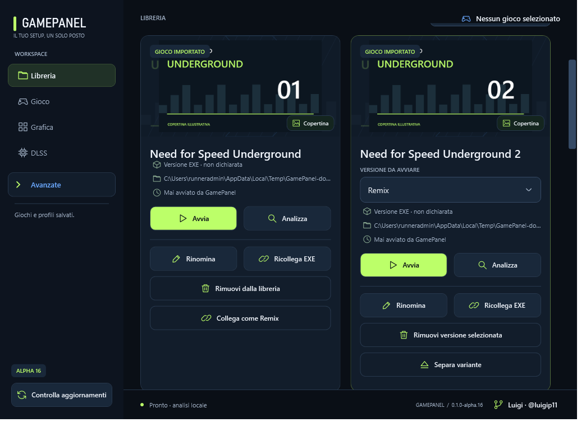

Gioco e specifiche hardware

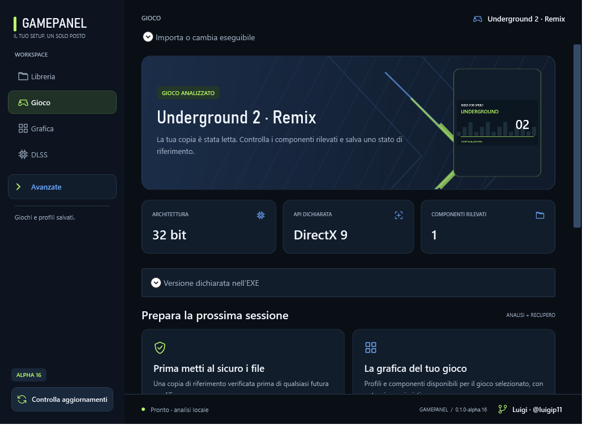

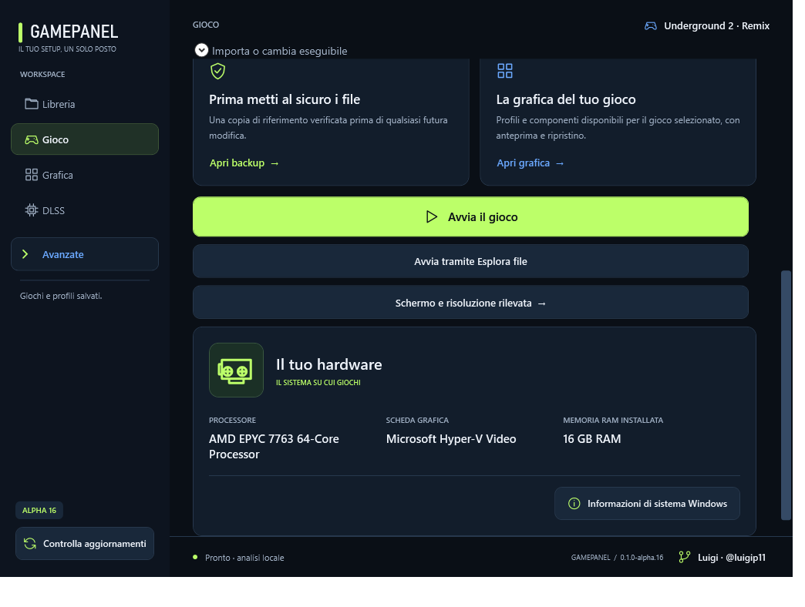

Grafica del gioco

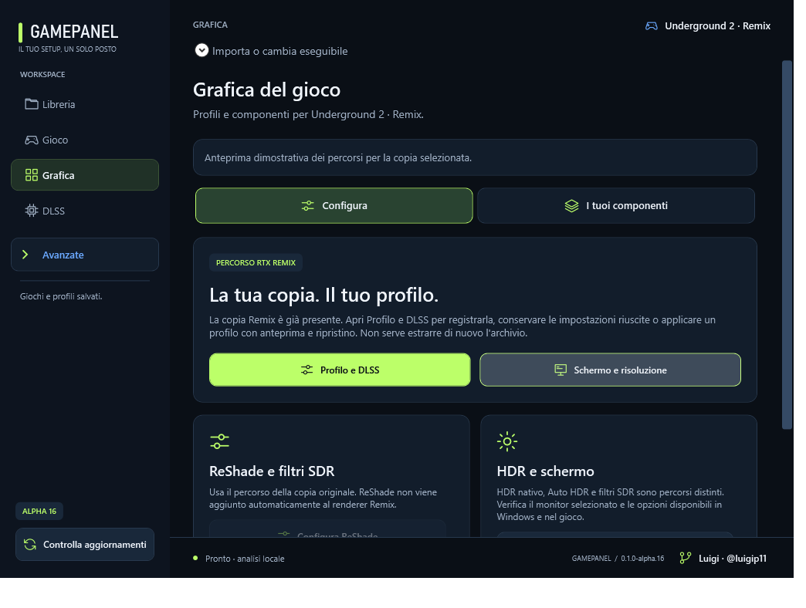

DLSS: configurazione e parametri

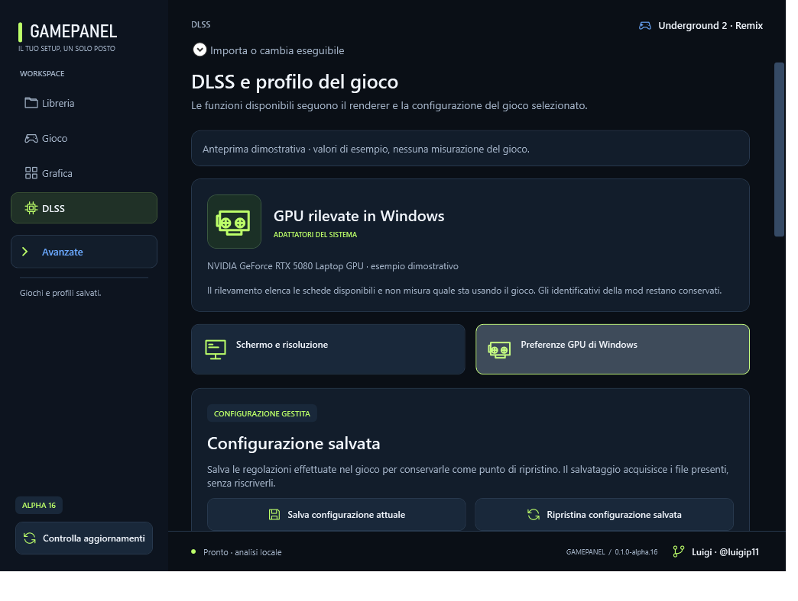

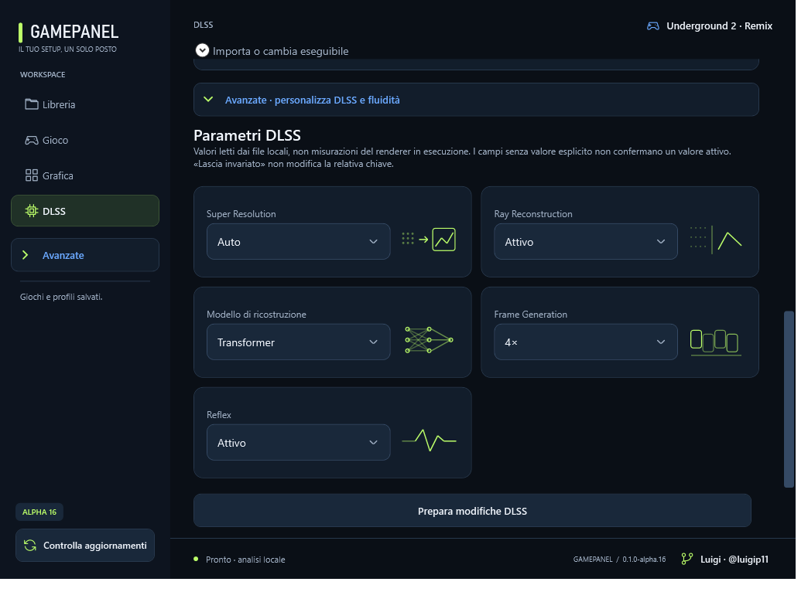

Schermo e configurazione avanzata

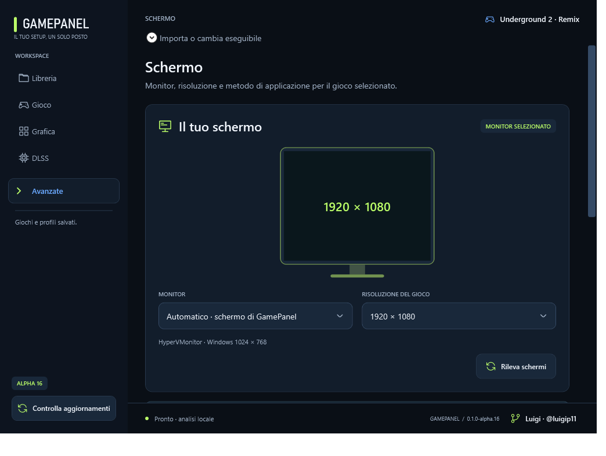

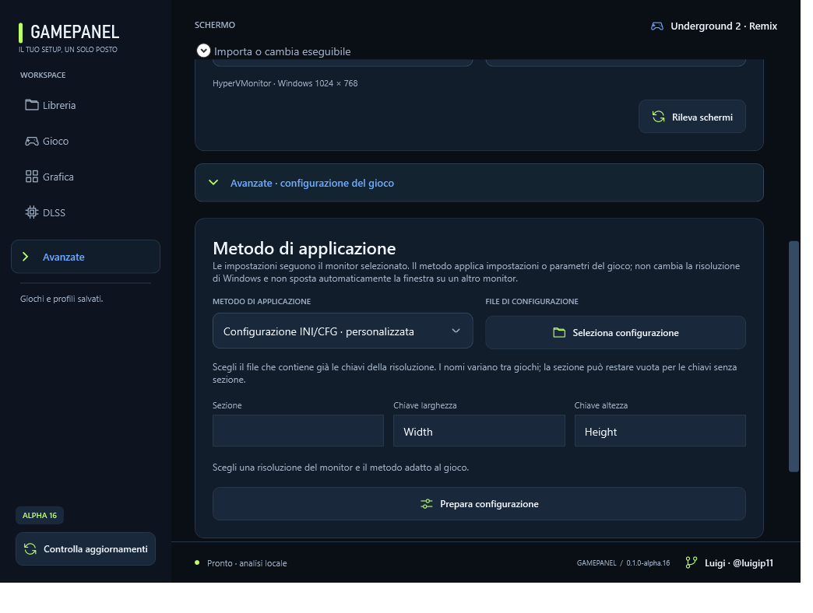

HDR e schermo

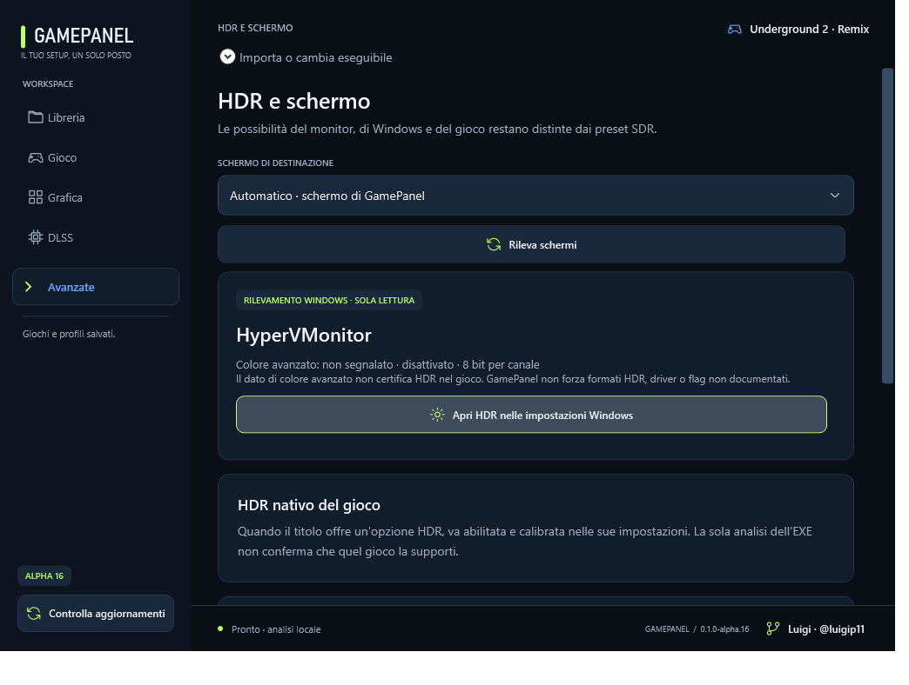

Backup e punti di ripristino

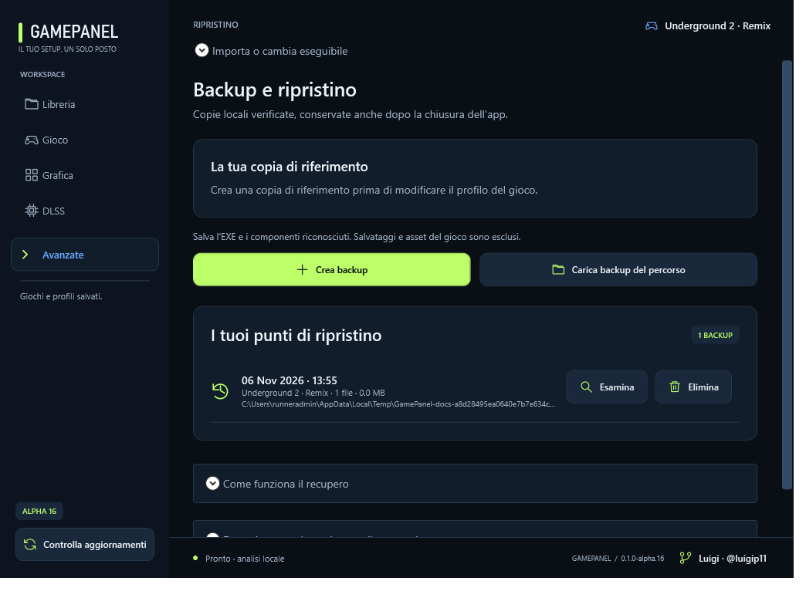

Verifica: **273/273 controlli core Windows superati**, controlli UI, avvio, updater e launcher Explorer riusciti. Le copie Remix generate richiedono un collaudo nel gioco sul PC dell'utente.
