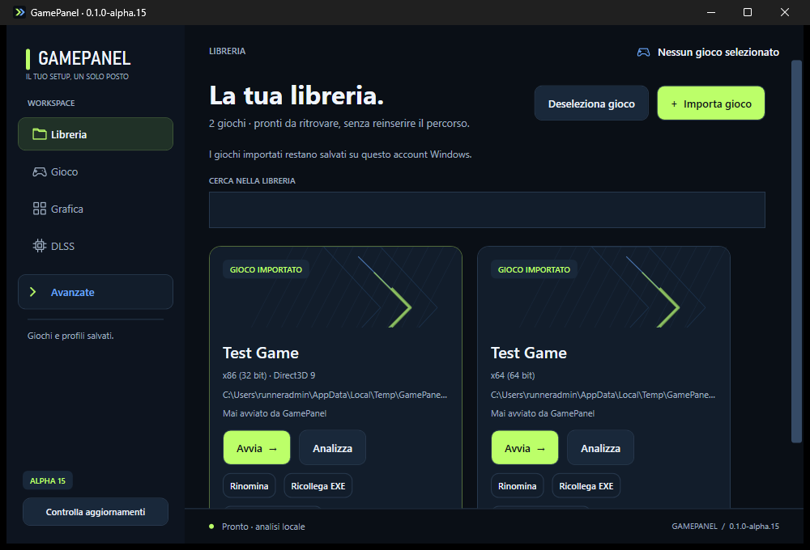
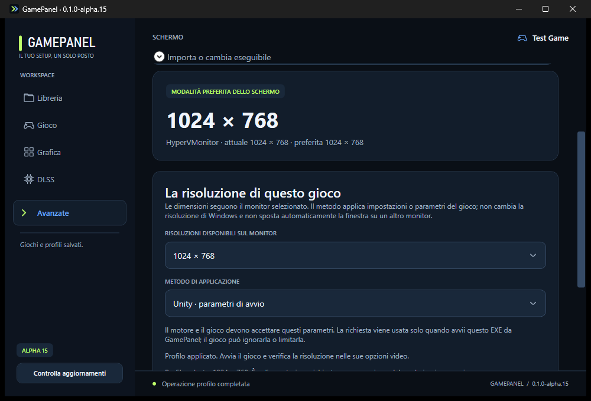

# GamePanel — DLSS e ReShade per i tuoi giochi

GamePanel è un’app Windows che riunisce in un’unica interfaccia la libreria dei giochi e la gestione delle configurazioni grafiche. Permette di importare un gioco dal suo eseguibile, analizzarne i componenti e accedere alle funzioni disponibili per quel titolo.

Il progetto comprende la gestione delle configurazioni DLSS per le copie RTX Remix riconosciute, gli strumenti HDR/ReShade e l’importazione di pacchetti grafici compatibili, con backup e ripristino. Le opzioni specifiche compaiono in base al gioco selezionato; gli strumenti tecnici sono raccolti in **Avanzate**. La compatibilità dipende dal gioco e dai componenti installati.

## Download

**[Scarica GamePanel alpha.15 per Windows x64 — archivio ZIP](https://github.com/luigip11/GamePanel/actions/runs/41853780317/artifacts/13337430101)**

La build alpha.15 è distribuita come artefatto GitHub Actions: per scaricarla serve accedere a GitHub. Estrarre tutto l’archivio in una cartella nuova e avviare **GamePanel.exe**. Guide, licenze e materiali sono raccolti in **Docs**, **Licenses** e **Assets**. Giochi, asset e runtime RTX Remix non sono inclusi.

## Changelog alpha.15

- Profili di risoluzione per gioco basati sul monitor selezionato, con anteprima, applicazione e ripristino.
- Metodo dedicato a Underground 1 con Widescreen Fix verificato; parametri di avvio Unity/Unreal e configurazioni INI/CFG personalizzate.
- Recupero delle operazioni interrotte e conservazione delle modifiche esterne ai file di configurazione.
- Gestione del nuovo EXE NoCD UG2 identificato, con registrazione esplicita del cambio e confronto corretto dei percorsi Windows.
- Icona GamePanel incorporata negli EXE; runtime incluso negli eseguibili, guide in **Docs**, licenze in **Licenses** e materiali in **Assets**.

La compatibilità dipende dal gioco e dal metodo scelto. Il profilo salva una richiesta di risoluzione: verificarne l’effetto nel gioco. [Guida alla risoluzione](docs/RESOLUTION-PROFILES.md).

## Schermate

Schermate reali di GamePanel alpha.15 nell’ambiente di test Windows; le voci dei giochi sono dimostrative.

### Libreria

### Schermo e risoluzione

