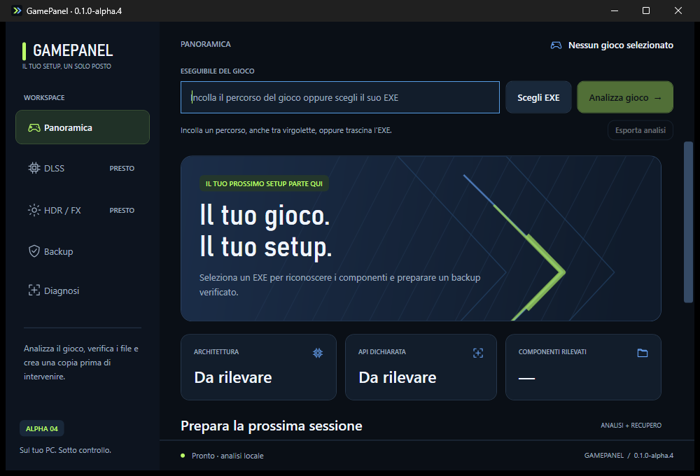
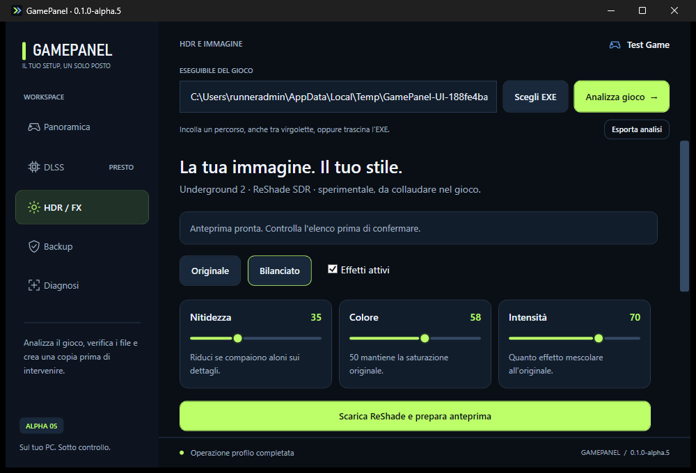
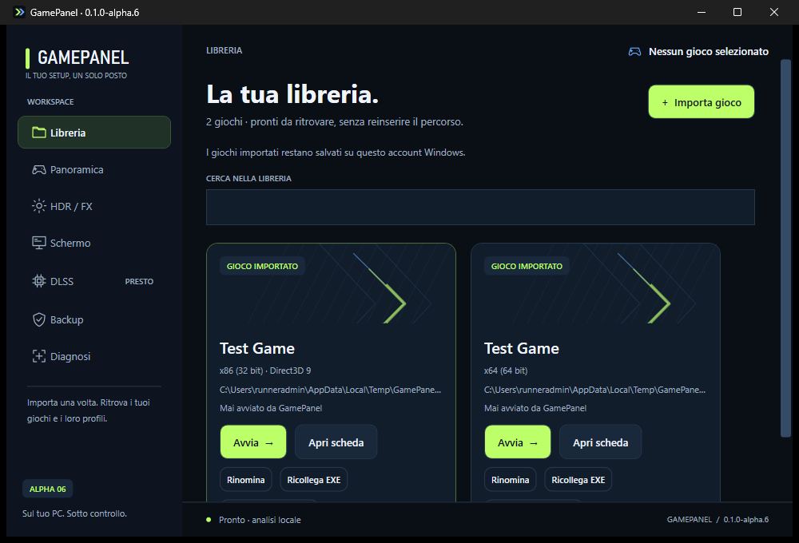
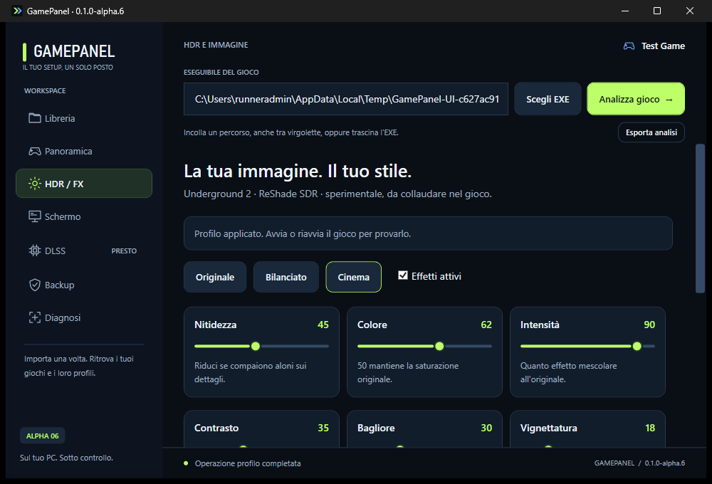

# Interfaccia gaming — alpha.4

## Direzione visiva

Workspace scuro con superfici blu carbone, accenti lime e blu elettrico, illustrazione vettoriale originale e tipografia Segoe UI/Bahnschrift disponibile su Windows. Nessun font web, wallpaper remoto, logo di terzi o immagine di gioco scaricata automaticamente.

Schermata nativa acquisita dalla pipeline Windows del commit `cbb224ae5b57e8af788b80da412a1318482fdc05`, con nessun gioco selezionato. Il successivo aggiornamento al selettore dei backup non modifica questa panoramica.

La panoramica dà priorità a selezione EXE, analisi, dati rilevati e accesso al backup. La scheda del gioco usa il nome della cartella o dell'EXE come etichetta; non identifica con certezza il titolo dal solo percorso.

## Decisioni di UX

- Un'azione primaria per analizzare l'EXE; scelta file e incolla sempre visibili, con supporto Invio.
- Navigazione con icone e stato selezionato; DLSS/HDR esplicitamente in sviluppo.
- Metriche solo dal report: architettura, prima API dichiarata e numero di componenti. Nessun FPS, carico GPU o guadagno prestazionale simulato.
- Backup con azioni e anteprima prima delle spiegazioni secondarie; dettagli di recupero e permessi espandibili.
- Focus, pressione e disabilitazione riconoscibili; icone accompagnate da testo; stato lungo abbreviato con contenuto completo nel tooltip.
- Titolo Windows scuro solo per la finestra dell'app: non cambia tema globale, registro o protezioni.
- Icona vettoriale originale e grafica statica per limitare il lavoro grafico durante i giochi.

## Verifica

La pipeline prova avvio, percorso quotato e ciclo backup/ripristino con UI Automation. Produce le immagini reali `00-overview.png` e `01-backup.png` nell'artifact **GamePanel-interface-preview**. Esito e screenshot appartengono alla specifica build; non sono mockup.

Restano da collaudare sul PC reale le diverse scale DPI, il display e Smart App Control. Il restyling non attribuisce fiducia Windows: alpha.4 resta non firmata finché non è completato il percorso in SIGNING.md.

## Alpha.5 — controlli immagine reali

Schermata Windows del commit `393e70ce6f5d0540b5d763537f160ca0076971c6`, su una fixture sintetica. Nitidezza, Colore e Intensità sono raggruppati in tre schede con cursori lime, focus da tastiera e valori numerici. Originale disattiva la tecnica; Bilanciato imposta valori moderati. Qualsiasi modifica ai parametri invalida l'anteprima precedente. Dopo la preparazione, l'app porta in vista il pulsante di conferma. Durante le operazioni i controlli sono disabilitati e l'annullamento resta disponibile.

L'etichetta Avvia il gioco usa lo stato attualmente applicato; non promette di escludere mod già installate. DLSS rimane in sviluppo; HDR non è abilitato da questo profilo SDR.

## Alpha.6 — libreria e Cinema

Schermate native della build `105d9a5`, con fixture sintetiche. La libreria è la pagina iniziale e nasconde il campo percorso: importazione una volta, schede salvate, ricerca, avvio e gestione dei collegamenti. Non sono usati store, copertine remote o dati prestazionali inventati. Nomi/API delle schede provengono dall'ultima analisi e sono rianalizzati quando si apre o avvia il gioco.

Il pannello Immagine aggiunge Cinema e tre nuove regolazioni; la pagina Schermo distingue l'obiettivo 3440×1440 dalla risoluzione dichiarata nell'ultimo log. Le due installazioni hanno anteprima e rimozione distinte. Il menu resta leggibile anche nella finestra minima; le pagine lunghe scorrono verticalmente.
